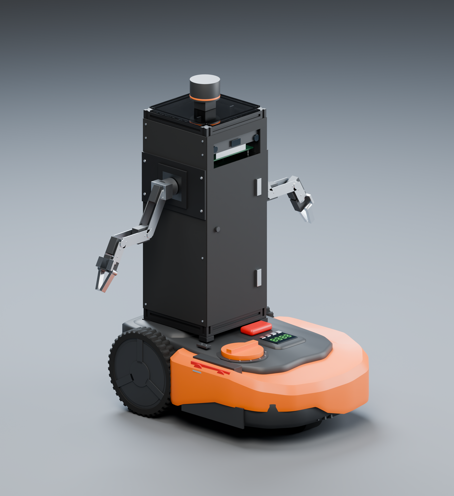

# Underbot R10

Corrected WR141E-based dual-arm rover: **200 × 200 mm transparent polycarbonate floors**, **black aluminium frame**, **four matte-black plastic covers**, **204 × 204 mm covered tower**, and **500 mm posts**. The stripped Kinect reservation is inside the frame. Two budget arms, each with five arm axes plus a gripper, mount directly to frame brackets.



## Current files

- [Complete R10 export and instructions](final_exports/Underbot_Corrected_R10/README.md).
- [Assembled STL](final_exports/Underbot_Corrected_R10/stl/Underbot_R10_assembled_mm.stl): millimetres, 293 separate closed components.
- [Textured GLB](final_exports/Underbot_Corrected_R10/models/Underbot_R10_textured.glb): metres, embedded 2048 px PBR maps.
- [Editable Blender scene](final_exports/Underbot_Corrected_R10/models/Underbot_R10_studio.blend): packed textures and studio lights.
- [Portable URDF](underbot_description/urdf/underbot.portable.urdf), [ROS URDF](underbot_description/urdf/underbot.urdf), [Xacro](underbot_description/urdf/underbot.urdf.xacro) and [textured OBJ URDF](underbot_description/urdf/underbot.textured.urdf).
- [Offline joint viewer](underbot_description/viewer.html): download or clone first, then open locally.
- [Cutaway](final_exports/Underbot_Corrected_R10/renders/Underbot_R10_cutaway.png), [rear](final_exports/Underbot_Corrected_R10/renders/Underbot_R10_rear.png) and [mower only](final_exports/Underbot_Corrected_R10/renders/Underbot_R10_base.png).

[Download repository ZIP](https://github.com/gautamsajeen/UnderBot-Personal/archive/refs/heads/main.zip). Keep each URDF with its meshes. STL has no textures; GLB/Blender carry the full appearance. The top-level ROS package matches the self-contained R10 bundle. R10 supersedes earlier exports, which remain as historical versions.

## Dimensions and validation

The WR141E uses its published 558 × 404 × 205 mm envelope. Supplier data supports rear/front wheel diameters of 205/79 mm. Reconstructed rear tyre width 40 mm, track 334 mm, wheelbase 340 mm, body contours and mounting position are estimates. [Source register](final_exports/Underbot_Corrected_R10/docs/WR141E_reference_register.md).

**6,098 independent checks passed**, covering 293 components and 250,452 triangles: exported bounds, units, transforms, closed component surfaces, four opaque black covers, clear floors and black profiles. [Independent audit](final_exports/Underbot_Corrected_R10/validation/independent_geometry.md).

The URDF has 23 links and 22 joints: four fixed, fourteen commanded coordinates, two passive caster coordinates and two gripper mimic followers. Four fixed-link merges leave 19 bodies. Estimated mass is 19.5172478 kg. Actual-file PyBullet import, Xacro consistency, MuJoCo motion, static balance and offline-viewer transform checks pass. [Delivery report](final_exports/Underbot_Corrected_R10/validation/final_delivery.json).

Bare Kinect geometry, arm dimensions, actuator ratings, installed masses and mounting details remain unmeasured. This is a documented simulation model, not factory CAD or a measured hardware twin. Native Gazebo, Isaac Sim/Lab, RViz2 and FreeCAD have not been executed. Aggregate visual shells have intentional interfaces; use separate collision primitives for physics. [Accuracy register](underbot_description/docs/accuracy_and_physics.md).

## Simulation

Place `underbot_description` in a ROS 2 workspace's `src` folder:

```sh
colcon build --packages-select underbot_description --symlink-install
source install/setup.bash
ros2 launch underbot_description display.launch.py
```

Follow the [import guide](underbot_description/docs/simulation_import.md) and [reproduction instructions](final_exports/Underbot_Corrected_R10/README.md#validation-and-reproduction). The root compatibility URDFs reference the current package geometry and physical model. The legacy basic mesh generator replaces detailed visuals; follow the full R10 rebuild to preserve detail and textures.
